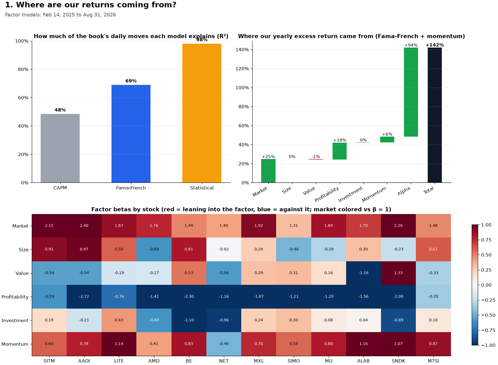
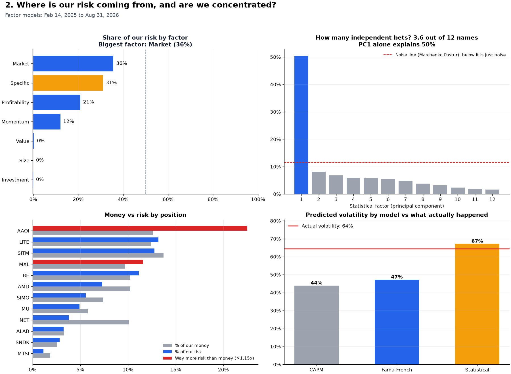
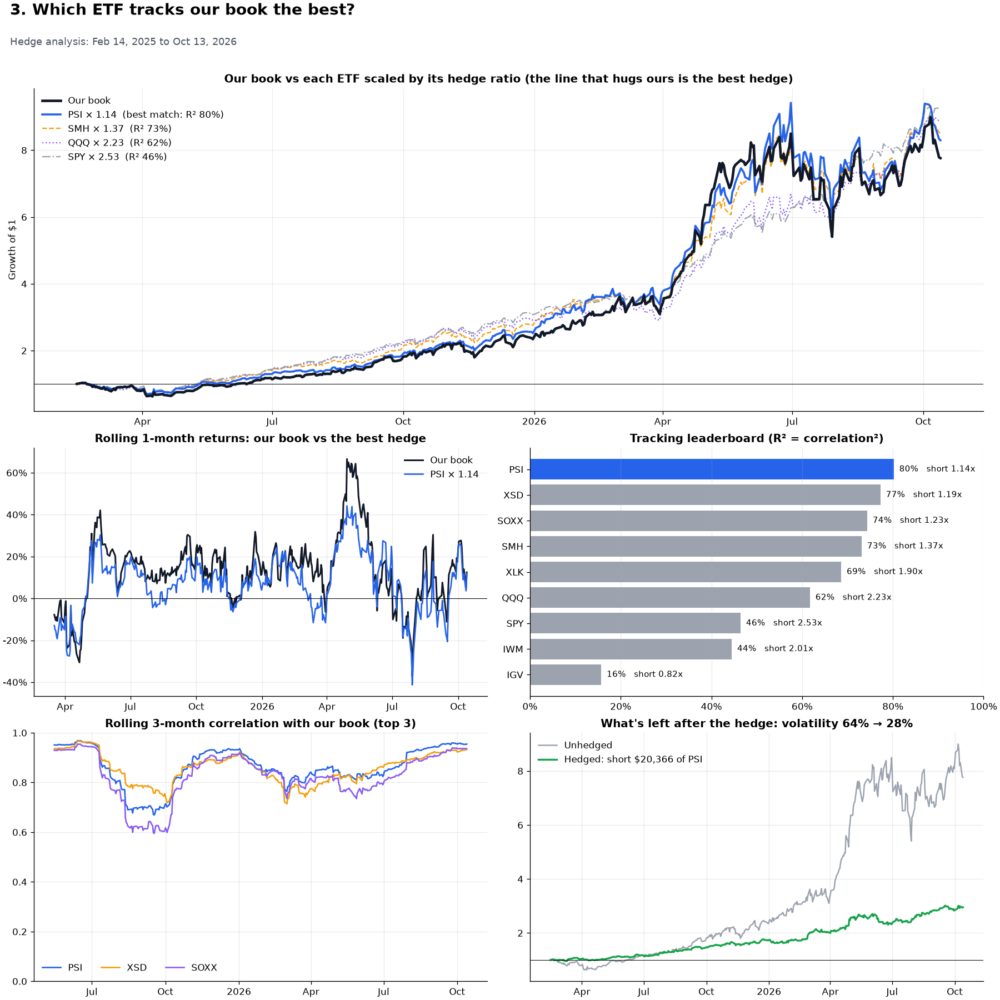

# Factor Risk Model

Three questions about my semiconductor / AI-infrastructure book:

1. **Where are my returns coming from?**
2. **Where is my risk coming from, and am I concentrated in one factor?**
3. **Which ETF tracks my book the best, and how much do I short to go market neutral?**

**Try it:** enter any stocks and weights in the web app (see [Website](#website)). Full proofs of every formula are in [MATH.md](MATH.md).

## Why factor models

A risk model needs a covariance matrix: how every stock moves with every other stock. The obvious move is to calculate it straight from historical returns. That breaks fast:

- **Too many numbers.** A full covariance matrix has $N(N+1)/2$ entries. For 6,000 stocks that's **18,003,000** numbers to estimate.
- **Not enough data.** The matrix is only invertible if you have more days of history than stocks ($T > N$). With demeaned returns $X$, the sample covariance is $S = \frac{1}{T-1}X^\top X$, so $\text{rank}(S) \le T - 1$. With fewer days than stocks, some eigenvalues are exactly zero: the matrix can't be inverted, and an optimizer thinks certain portfolios have zero risk. Covering 6,000 stocks would take about 24 years of daily data.

Factor models fix this. We still use historical returns, but only to estimate a few betas per stock. The assumption: stocks move together **only because they share factors**.

$$r_i = \alpha_i + \beta_i^\top f + \varepsilon_i \quad\Longrightarrow\quad \text{Cov}(r_i, r_j) = \beta_i^\top F \beta_j \;\; (i \neq j)$$

$$\Sigma = B F B^\top + D$$

| Piece | What it is | Size |
|---|---|---|
| $B$ | each stock's factor betas | $N \times K$ |
| $F$ | factor covariance | $K \times K$ |
| $D$ | specific (stock-only) variance | diagonal, $N$ |

With 6 factors and 6,000 stocks that's **42,021** numbers instead of 18 million.

**And the result is always positive definite.** For any $x \neq 0$:

$$x^\top \Sigma x = \underbrace{(B^\top x)^\top F (B^\top x)}_{\ge 0} + \underbrace{\textstyle\sum_i d_i x_i^2}_{> 0} > 0$$

So every eigenvalue is positive and the matrix can always be inverted. Both claims (the sample matrix breaking and the factor matrix holding) are proven step by step in [MATH.md](MATH.md) and checked with code in `tests/test_math.py`.

## The three models

| Model | Factors | How we get $B$ |
|---|---|---|
| **CAPM** | Market | Regression of each stock on the market |
| **Fama-French + momentum** | Market, Size, Value, Profitability, Investment, Momentum | Same regression, six factors |
| **Statistical (PCA)** | Hidden factors the data finds on its own | Eigenvectors of the return covariance, keeping only the ones above the Marchenko-Pastur noise line $\lambda_+ = (1 + \sqrt{N/T})^2$ |

All three produce $B$, $F$, $D$, so the same risk code runs on every one of them.

## What the report shows





**Return attribution** regresses the whole book on the factors. Because a regression with a constant forces the leftover to average zero, the pieces add up exactly: $\bar r_p = \alpha + \sum_k \beta_k \bar f_k$.

**Risk attribution** uses $\text{Var}(r_p) = b^\top F b + \text{Var}(\varepsilon)$, where each factor's share is $b_k (Fb)_k$. Concentration is measured by the **effective number of bets**, $(\sum \lambda)^2 / \sum \lambda^2$ from the correlation matrix's eigenvalues: 12 independent stocks score 12, everything moving as one scores 1.

**The hedge.** Shorting $h$ of an ETF gives $\text{Var}(r_p - h r_e) = \sigma_p^2 - 2h\sigma_{pe} + h^2\sigma_e^2$. Setting the derivative to zero:

$$h^* = \frac{\text{Cov}(r_p, r_e)}{\text{Var}(r_e)} \qquad \text{Var}(r_p - h^* r_e) = \sigma_p^2 (1 - \rho^2)$$

So the best hedge is simply the ETF with the highest correlation to the book.

## Run it

```bash
python3 -m venv .venv
source .venv/bin/activate
pip install -r requirements.txt
python -m pytest      # prove the math
python main.py        # build the report
```

Settings (start date, book size) are at the top of `main.py`.

## Website

```bash
python -m streamlit run app.py
```

Opens in the browser: type in any holdings and weights, hit **Run analysis**, and get the same three-part report. It runs the exact same code as `main.py` (both call `riskmodel/pipeline.py`).

**Put it online for free** with [Streamlit Community Cloud](https://share.streamlit.io): sign in with GitHub, choose **Create app**, pick this repo, set the main file to `app.py`, and deploy. You get a public link to put on a resume. Data: prices from Yahoo Finance, factors from the [Kenneth French Data Library](https://mba.tuck.dartmouth.edu/pages/faculty/ken.french/data_library.html).

## Layout

```
main.py              terminal version: prints the story, saves charts to reports/
app.py               website version: anyone can enter holdings and run it
MATH.md              proofs of every formula used
riskmodel/
  pipeline.py        runs everything; main.py and app.py both call it
  data.py            prices, returns, Fama-French factors
  models.py          CAPM, Fama-French, statistical model (each returns B, F, D)
  risk.py            Σ = BFBᵀ + D, positive-definite check, attribution
  hedge.py           hedge ratio and ETF ranking
  charts.py          the three charts
tests/test_math.py   proves the math with fake data where we know the answer
```

## Limitations

- **At 12 stocks, the direct covariance actually works** (78 numbers, ~400 days of data), so realized volatility serves as the benchmark. The factor approach is what scales to a full universe, and it's what explains *why* the risk is there.
- **Weights are held at today's values** across the whole history ("what would today's book have done").
- **Everything is in-sample.** Alpha especially: these names were picked partly because they performed well.
- **French data lags** a month or two, so the factor sections end earlier than the hedge section.

## Next steps

- Fundamental (Barra-style) model: the third classic family, where factor returns are estimated cross-sectionally each day
- Run the statistical model on a ~120-name semis universe instead of just the holdings
- Out-of-sample hedge test: fit the hedge ratio on one period, check it on the next
